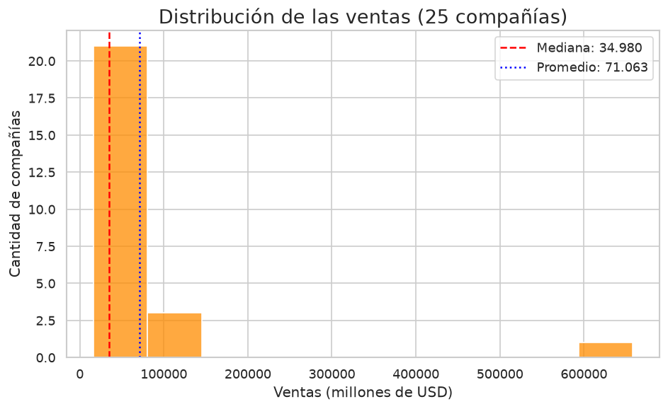
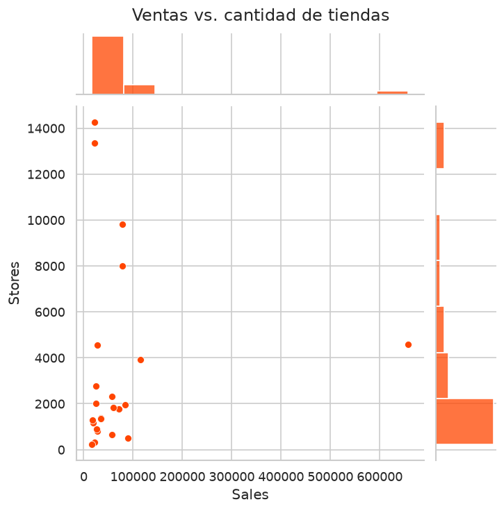
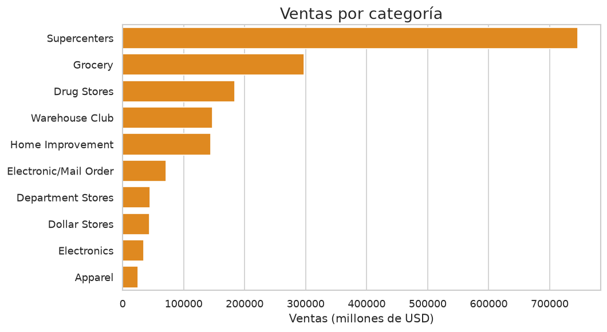
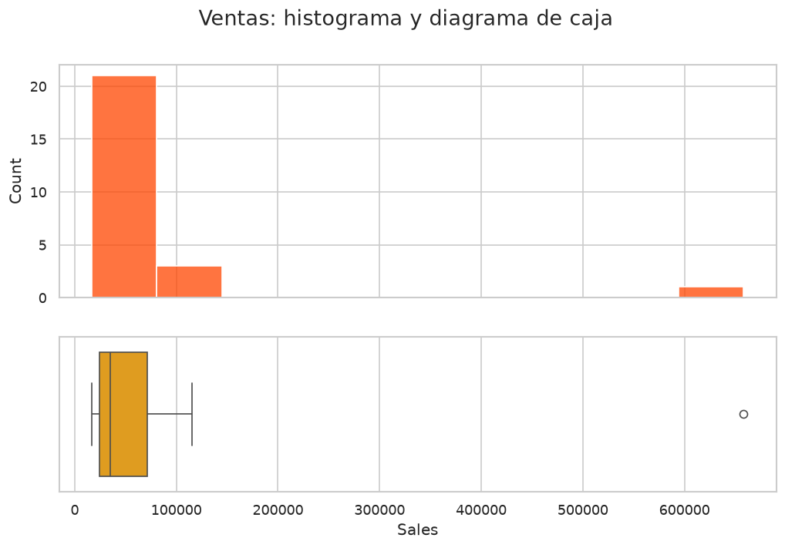
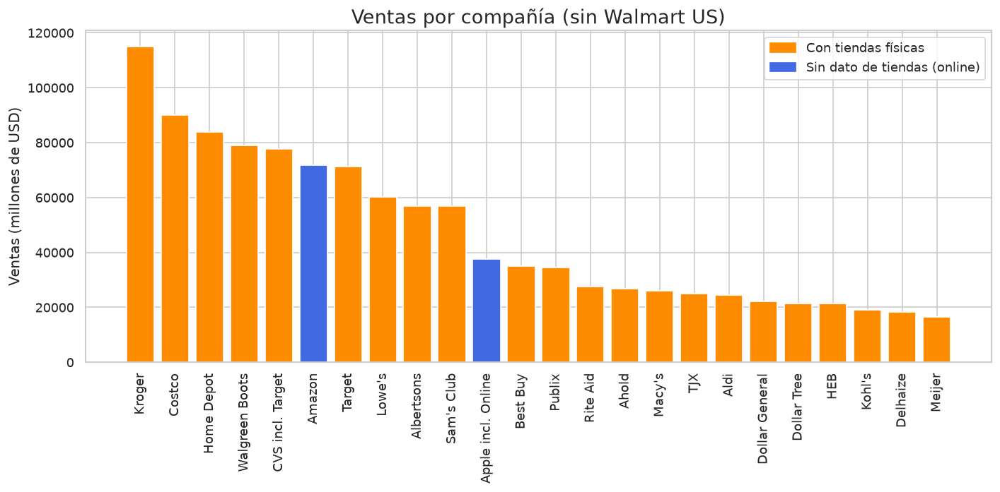

# 🛒 Análisis de los 25 Retailers más grandes de EE. UU.


Proyecto final del reto de **Data Science** de **Platzi (Data Academy)**. A partir de un dataset con las 25 compañías de retail más grandes de Estados Unidos, se responden 11 preguntas de negocio aplicando **estadística descriptiva** con Python: medidas de tendencia central, dispersión, cuartiles, correlación y detección de outliers.

> 📓 **El análisis completo está en [`notebooks/analisis_retailers.ipynb`](notebooks/analisis_retailers.ipynb)**, con el código, los gráficos y la respuesta a cada pregunta.

---

## Tabla de contenidos

1. [Dataset](#-dataset)
2. [Preguntas y resultados](#-preguntas-y-resultados)
3. [Gráficos](#-gráficos)
4. [Conceptos estadísticos aplicados](#-conceptos-estadísticos-aplicados)
5. [Visualización en Power BI](#-visualización-en-power-bi)
6. [Estructura del repositorio](#-estructura-del-repositorio)
7. [Cómo ejecutarlo localmente](#-cómo-ejecutarlo-localmente)
8. [Notas y limitaciones](#-notas-y-limitaciones)
9. [Cómo contribuir](#-cómo-contribuir)
10. [Autora](#-autora)

---

## 📊 Dataset

[`data/largest_us_retailers.csv`](data/largest_us_retailers.csv): 25 compañías, una por fila.

| Columna | Significado |
|---|---|
| `Company` | Nombre de la compañía |
| `Sales` | Ventas anuales, en millones de USD |
| `Stores` | Cantidad de tiendas físicas |
| `Sales/Avg. Store` | Ventas por tienda promedio, en millones de USD |
| `Store Count Growth` | Crecimiento de la cantidad de tiendas (proporción) |
| `Category` | Categoría de la compañía |

Amazon y Apple incl. Online no tienen dato de tiendas, y Apple tampoco de categoría.

---

## ❓ Preguntas y resultados

### I. Preguntas del negocio

| # | Pregunta | Resultado |
|---|---|---|
| 1 | ¿Cuál es el promedio de ventas sin contar a la compañía dominante? | **USD 46.602 millones** (sin Walmart US) |
| 2 | ¿Cuánto dinero en ventas generó la mayoría de las compañías? | **USD 34.980 millones** (mediana) |
| 3 | ¿Cuántas tiendas tiene la mayoría de las compañías? | **1.828 tiendas** (mediana); 13 de 23 tienen menos de 2.000 |
| 4 | ¿La cantidad de tiendas está relacionada con las ventas? | **No de forma clara:** correlación de Pearson 0,06 y de Spearman 0,30 |
| 5 | ¿Cuál es el rango de las ventas? | **USD 641.527 millones** |
| 6 | ¿Cuáles son las 5 empresas con más tiendas y cuáles están también entre las 5 con más ventas? | Dollar Tree, Dollar General, CVS incl. Target, Walgreen Boots y Walmart US. **En ambos rankings:** Walmart US y Walgreen Boots |

### II. Preguntas opcionales

| # | Pregunta | Resultado |
|---|---|---|
| 7 | ¿Qué categoría generó más ventas? | **Supercenters** (USD 745.919 millones), seguida de Grocery y Drug Stores |
| 8 | ¿Qué compañía genera más ventas en relación con su cantidad de tiendas? | **Costco** (USD 187,8 millones por tienda) |
| 9 | ¿Qué compañías venden solo online y destacan sobre las demás? | Amazon y Apple incl. Online (sin tiendas informadas): su mediana de ventas (54.676) supera a la de las compañías con tiendas (34.408) |

### III. Preguntas propias

| # | Pregunta | Resultado |
|---|---|---|
| 10 | ¿Cuáles son los outliers? | Ventas: **Walmart US**. Tiendas: **Dollar Tree, Dollar General y CVS incl. Target** |
| 11 | ¿Qué compañía tuvo menos ventas? | **Meijer** (USD 16.592 millones) |

**Conclusión general:** Walmart US domina el mercado y distorsiona el promedio, por eso la mediana es la medida más representativa. Además, tener más tiendas no implica vender más: importan el tipo de negocio y las ventas por tienda.

---

## 📈 Gráficos

<table>
  <tr>
    <td></td>
    <td></td>
  </tr>
  <tr>
    <td></td>
    <td></td>
  </tr>
</table>



---

## 🧮 Conceptos estadísticos aplicados

| Concepto | Qué es | Uso en el proyecto |
|---|---|---|
| **Media (promedio)** | Suma de los valores dividida por la cantidad de valores | Pregunta 1 |
| **Mediana** | Valor central: deja la mitad de los datos a cada lado. Resiste a los valores extremos | Preguntas 2 y 3, por el sesgo que genera Walmart US |
| **Rango** | Diferencia entre el máximo y el mínimo | Pregunta 5 |
| **Cuartiles (Q1, Q2, Q3)** | Dividen los datos ordenados en cuatro partes: 25 %, 50 % y 75 % | Pregunta 10 |
| **Rango intercuartil (IQR)** | Q3 − Q1: abarca el 50 % central de los datos | Detección de outliers |
| **Desviación estándar** | Qué tan dispersos están los datos respecto de la media | Pregunta 10 |
| **Correlación** | Mide si dos variables se mueven juntas (Pearson usa los valores, Spearman usa el orden) | Pregunta 4 |
| **Outliers** | Valores fuera de `[Q1 − 1,5·IQR ; Q3 + 1,5·IQR]`, visibles en el diagrama de caja | Pregunta 10 |

> **Por qué la mediana en las preguntas 2 y 3:** el promedio de ventas de las 25 compañías es 71.063, pero la mediana es 34.980. Walmart US eleva el promedio a un valor que casi ninguna compañía alcanza; la mediana, en cambio, apenas cambia si se la excluye (34.694).

---

## 🎨 Visualización en Power BI

Además del análisis en Python, se armó un tablero en Power BI a modo de práctica, para explorar los datos de forma interactiva:


---

## 📂 Estructura del repositorio

```
Proyecto-Data-Science-2022--Analisis-Retails--Reto/
├── README.md
├── LICENSE
├── requirements.txt              # librerías necesarias
├── .gitignore
├── data/
│   └── largest_us_retailers.csv  # dataset
├── notebooks/
│   └── analisis_retailers.ipynb  # análisis completo
└── docs/
    └── images/                   # gráficos generados por el notebook
```

---

## 🚀 Cómo ejecutarlo localmente

**Requisitos:** Python 3.9 o superior y [Git](https://git-scm.com/downloads). Se recomienda [VS Code](https://code.visualstudio.com/) con las extensiones *Python* y *Jupyter*.

### 1. Clonar el repositorio

```bash
git clone https://github.com/Jeanette22/Proyecto-Data-Science-2022--Analisis-Retails--Reto.git
cd Proyecto-Data-Science-2022--Analisis-Retails--Reto
```

### 2. Crear un entorno virtual e instalar las dependencias

```bash
python -m venv .venv

# Activar el entorno
.venv\Scripts\Activate.ps1      # Windows (PowerShell)
source .venv/bin/activate       # macOS / Linux

pip install -r requirements.txt
```

### 3. Abrir y ejecutar el notebook

**En VS Code:** abrí `notebooks/analisis_retailers.ipynb`, elegí como *kernel* el entorno `.venv` (arriba a la derecha) y presioná **Run All**.

**O con Jupyter:**

```bash
pip install jupyterlab
jupyter lab
```

Al ejecutarlo se regeneran los gráficos de `docs/images/`.

---

## ⚠️ Notas y limitaciones

- Son solo **25 compañías**: las conclusiones describen este conjunto y no se pueden generalizar sin más datos.
- Las ventas se interpretan en **millones de USD** (supuesto del enunciado del reto).
- En la pregunta 9, "online" se define como **no tener dato de tiendas físicas**; es una suposición, ya que el dataset no lo indica. "Apple incl. Online" probablemente incluya también sus tiendas.
- En el dataset, `Warehouse Club` y `Warehouse Clubs` aparecen como categorías distintas; en el análisis se unificaron.
- El proyecto se desarrolló originalmente en **Deepnote** (Python 3.7). Esta versión corre en local con versiones actuales de pandas y Seaborn.

---

## 🤝 Cómo contribuir

Cualquier sugerencias y mejoras son bienvenidas!! Este proyecto es parte de mi proceso de aprendizaje *esta epoca estaba en los inicios de analiticas

1. Hacé un **fork** del repositorio.
2. Creá una rama: `git checkout -b feat/mi-mejora`
3. Hacé tus cambios y sus commits: `git commit -m "feat: descripción del cambio"`
4. Subí la rama: `git push origin feat/mi-mejora`
5. Abrí un **Pull Request** explicando qué cambia y por qué.

**Ideas para colaborar:** probar otros criterios para detectar outliers, sumar nuevas preguntas de negocio, o incorporar datos de más años para ver la evolución de las ventas.

---

## 👩‍💻 Autora

**Jeanette Mansilla** — [Portfolio](https://jeanettemansilla.netlify.app/) · [LinkedIn](https://www.linkedin.com/in/jeanettemansilla/) · [Tableau Public](https://public.tableau.com/app/profile/jeanettecrd/vizzes)

Distribuido bajo licencia MIT. Ver [`LICENSE`](LICENSE).
